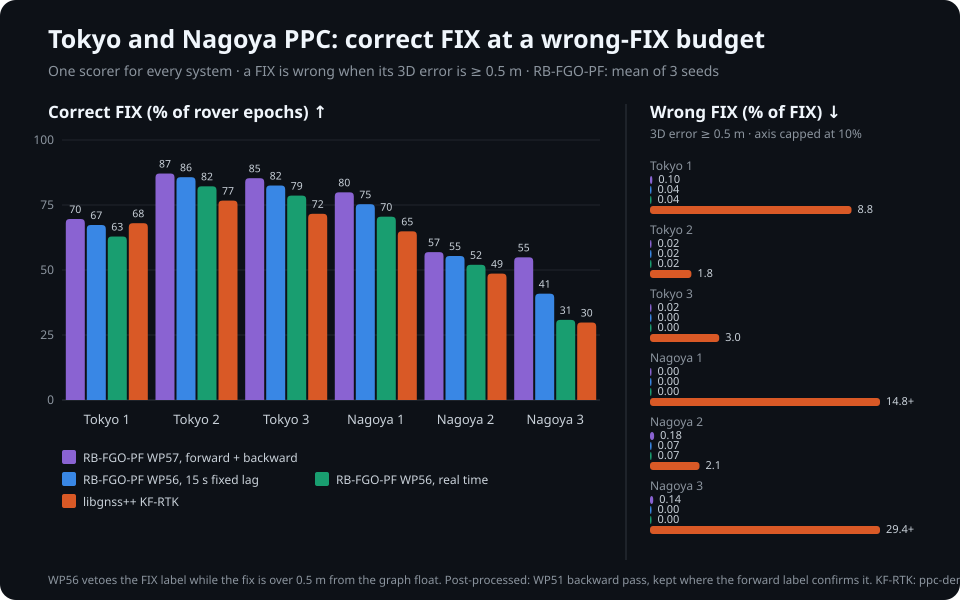
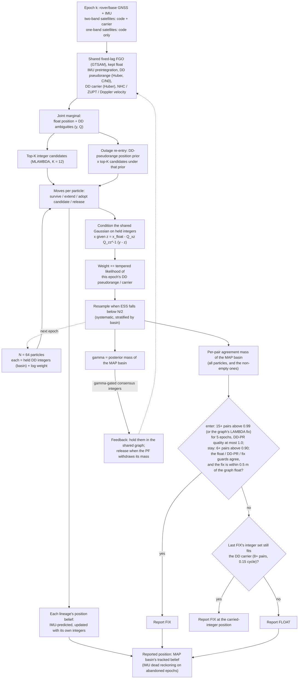
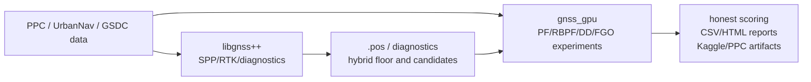

<div align="center">

# gnss_gpu

**GPU GNSS positioning for urban canyons: particle filters, ray-traced NLOS and factor graphs on real city data.**

[](LICENSE)
[](https://github.com/rsasaki0109/gnss_gpu/actions/workflows/ci.yml)
[](https://rsasaki0109.github.io/gnss_gpu/)
[](https://rsasaki0109.github.io/gnss_gpu/v0.3.0.html)
[](https://www.python.org/)
[](https://colab.research.google.com/github/rsasaki0109/gnss_gpu/blob/main/examples/colab_urban_canyon_quickstart.ipynb)

<p align="center">
  
  
</p>
<p align="center"><sub>Left: GPU particle filter on a real UrbanNav Odaiba drive. Right: ray-traced LOS/NLOS over PLATEAU 3D buildings.</sub></p>

[**v0.3 release audit**](https://rsasaki0109.github.io/gnss_gpu/v0.3.0.html) · [Live results snapshot](https://rsasaki0109.github.io/gnss_gpu/) · [Technical report](docs/technical_report_v0.3.0.md) · [Benchmarks](benchmarks/RESULTS.md) · [Examples](examples/) · [Input shapes](docs/common_input_shapes.md) · [GSDC2023 solution](docs/gsdc2023_solution.md) · [Experiment log](docs/experiments.md) · [Decisions](docs/decisions.md) · [How it's built](internal_docs/plan.md)

</div>

---

## What is this?

A research workspace for GNSS positioning in dense cities, where buildings
block and reflect signals. CUDA/C++ kernels and Python tools run GPU particle
filters, double-difference carrier tracking, ray tracing against 3D city
meshes and factor-graph optimization, scored against RTKLIB and EKF baselines
on public data (UrbanNav, PLATEAU, PPC, GSDC2023).

Rebuild and verify the v0.3 reproducibility archive:

```bash
python tools/build_release_bundle.py --output dist/reproducibility --archive dist/gnss_gpu-v0.3.0-reproducibility.zip
```

## Why you might care

- 🛰️ **Fills RTK gaps.** On UrbanNav Odaiba, RTK has the better median
  (libgnss++ 0.07 m, RTKLIB demo5 0.34 m) but misses 3–22% of epochs. Filling
  libgnss++ gaps with the GPU PF (1.50 m median, 98% coverage) raises epochs
  within 5 m from 74.5% to **87.8%** (RTKLIB 86.6%; Shinjuku 76.4% →
  **84.2%**, RTKLIB 73.5%).
- ⚡ **Fast.** A **1,000,000-particle** predict → weight → resample step takes
  **32 ms** on a 6 GB Turing GPU; a 10,000-epoch batch WLS solve **~3 ms**
  ([benchmarks](benchmarks/RESULTS.md)).
- 🏙️ **City-aware NLOS.** LOS/NLOS from PLATEAU 3D meshes, **57.8× BVH speedup**.
- 📈 **Reproducible scoring.** Same-input, same-metric comparisons; the
  [live snapshot](https://rsasaki0109.github.io/gnss_gpu/) is built from
  committed CSVs.

## RB-FGO-PF: integer ambiguity without premature collapse

Particles carry integer ambiguity hypotheses ("basins") on one shared float
GNSS/IMU factor graph (GTSAM), so a wrong fix competes with the right one
instead of being locked in by a ratio test. Six PPC runs, one scorer: a FIX
is correct within 0.5 m (3D), over all rover epochs. WP56 keeps wrong FIX at
or below 0.08% on every run and seed. Its real-time output uses no future
data; a 15 s fixed lag adds 3.4–10.1 pp, and the post-processed output
(a second, backward pass) 4.9–24.1 pp at 0.24% wrong or less.

| Correct FIX (wrong / FIX) | Tokyo 1 | Tokyo 2 | Tokyo 3 | Nagoya 1 | Nagoya 2 | Nagoya 3 |
|---|---:|---:|---:|---:|---:|---:|
| inuex35 TC-FGO (local reproduction) | 46.7% (5.72%) | 59.7% (1.78%) | 58.2% (2.06%) | – | – | – |
| libgnss++ GTSAM FGO | 37.7% (29.9%) | 77.3% (1.57%) | 68.2% (1.56%) | – | – | – |
| libgnss++ KF-RTK (`ppc-demo`, low-cost preset) | 68.0% (8.76%) | 76.7% (1.80%) | 71.6% (3.01%) | 64.9% (14.8%) | 48.6% (2.15%) | 29.8% (29.4%) |
| RB-FGO-PF WP43 (3 seeds) | 35.4% (0.33%) | 64.1% (0.16%) | 68.5% (0.10%) | – | – | – |
| RB-FGO-PF WP45, Tokyo-selected label (3 seeds) | 66.6% (0.56%) | 83.9% (0.09%) | 84.3% (0.04%) | 69.3% (0.70%) | 53.4% (8.53%) | 18.5% (16.2%) |
| RB-FGO-PF WP46 (3 seeds) | 56.1% (0.02%) | 76.4% (0.02%) | 75.8% (0.00%) | 61.0% (0.03%) | 46.5% (0.21%) | 12.3% (6.15%) |
| RB-FGO-PF WP47 (3 seeds) | 56.9% (0.01%) | 78.0% (0.01%) | 76.1% (0.04%) | 65.4% (0.01%) | 46.3% (0.71%) | 26.3% (0.49%) |
| RB-FGO-PF WP48 (3 seeds) | 56.4% (0.01%) | 78.7% (0.01%) | 74.8% (0.03%) | 66.5% (0.06%) | 47.8% (0.54%) | 27.4% (0.07%) |
| RB-FGO-PF WP50, real time (3 seeds) | 63.1% (0.05%) | 82.8% (0.02%) | 78.8% (0.00%) | 70.6% (0.00%) | 52.2% (0.13%) | 31.0% (0.04%) |
| RB-FGO-PF WP50, 15 s fixed lag (3 seeds) | 67.3% (0.05%) | 85.7% (0.02%) | 82.5% (0.00%) | 75.3% (0.00%) | 55.4% (0.13%) | 41.6% (0.03%) |
| RB-FGO-PF WP51, forward + backward, post-processed (3 seeds) | 69.3% (0.10%) | 87.1% (0.02%) | 83.6% (0.02%) | 79.9% (0.00%) | 56.8% (0.23%) | 55.8% (0.16%) |
| **RB-FGO-PF WP56, real time (3 seeds)** | **62.9% (0.04%)** | **82.2% (0.02%)** | **78.6% (0.00%)** | **70.5% (0.00%)** | **52.0% (0.07%)** | **30.8% (0.00%)** |
| **RB-FGO-PF WP56, 15 s fixed lag (3 seeds)** | **67.3% (0.04%)** | **85.7% (0.02%)** | **82.5% (0.00%)** | **75.3% (0.00%)** | **55.4% (0.07%)** | **40.9% (0.00%)** |
| RB-FGO-PF WP56, forward + backward, post-processed (3 seeds) | 69.3% (0.10%) | 87.1% (0.02%) | 84.6% (0.05%) | 79.9% (0.00%) | 56.9% (0.18%) | 54.9% (0.14%) |
| **RB-FGO-PF WP57, forward + backward, post-processed (3 seeds)** | **69.6% (0.10%)** | **87.1% (0.02%)** | **85.3% (0.02%)** | **79.9% (0.00%)** | **56.9% (0.18%)** | **54.9% (0.14%)** |

<p align="center">
  
</p>



Slips and outages remove the affected ambiguity from every particle.

| Shipped RB-FGO-PF (WP56 / WP57) quality, 3-seed mean | Tokyo 1 | Tokyo 2 | Tokyo 3 | Nagoya 1 | Nagoya 2 | Nagoya 3 |
|---|---:|---:|---:|---:|---:|---:|
| Correct FIX / rover epochs, real time | 62.9% | 82.2% | 78.6% | 70.5% | 52.0% | 30.8% |
| Wrong FIX / FIX ↓ (worst seed) | 0.04% (0.04%) | 0.02% (0.03%) | 0.00% (0.00%) | 0.00% (0.00%) | 0.07% (0.08%) | 0.00% (0.00%) |
| Correct FIX, 15 s fixed lag | 67.3% | 85.7% | 82.5% | 75.3% | 55.4% | 40.9% |
| Wrong FIX / FIX ↓ (worst seed) | 0.04% (0.04%) | 0.02% (0.03%) | 0.00% (0.00%) | 0.00% (0.00%) | 0.07% (0.08%) | 0.00% (0.00%) |
| Correct FIX, post-processed (WP51 backward pass) | 69.6% | 87.1% | 85.3% | 79.9% | 56.9% | 54.9% |
| Wrong FIX / FIX ↓ (worst seed) | 0.10% (0.18%) | 0.02% (0.03%) | 0.02% (0.05%) | 0.00% (0.00%) | 0.18% (0.24%) | 0.14% (0.18%) |
| PPC OFFICIAL (position only), real time (WP55 choice) | 85.5% | 93.7% | 92.3% | 77.2% | 57.5% | 83.7% |
| PPC OFFICIAL, 15 s fixed lag | 84.6% | 94.2% | 92.3% | 75.0% | 57.8% | 79.3% |
| PPC OFFICIAL, post-processed (WP51 + WP54 float selection) | 92.1% | 95.6% | 95.2% | 79.5% | 64.3% | 90.9% |
| PPC OFFICIAL, WP47 | 80.5% | 91.8% | 88.3% | 66.9% | 55.1% | 71.0% |

WP45 added the two-band satellite set and basin persistence, WP47 one-band
code-only satellites, WP48 Huber / C/N0 weighting and Doppler v2, WP50 the
hysteresis label and integer carry. WP51 reruns the filter on the
time-mirrored run and keeps the backward fixes the forward label confirms;
both passes fall into Nagoya 2's wrong basin, so their agreement alone is
never a FIX. WP54 then reports, on unfixed epochs, whichever of the
forward, backward or float positions best fits the carrier modulo whole
cycles: PPC OFFICIAL averages 86.3% over the six runs (WP51: 81.5%),
level with or slightly above the PPC2024 winner's 85.6%. FIX numbers score the `.pos` output as written (the WP50 numbers
first published also dropped guard-failing carried epochs). No external RTK
engine feeds the FIX label. WP55 applies the same choice in real time over
the last 6 epochs: PPC OFFICIAL 81.6% (WP50: 79.9%). WP56 (the default)
withholds the FIX label while the fix is more than 0.5 m from the graph's
float. On the backward pass, which the label was not tuned on, Nagoya 1's
wrong share falls from 1.23% to 0.04%, for 0.25 pp fewer real-time fixes;
PPC OFFICIAL does not change. WP57 takes the backward pass's IMU bias from
a parked window instead of the run's end (mid-turn on Tokyo 3): backward
Tokyo 3 rises from 59.9% to 80.0% correct FIX, and post-processed PPC
OFFICIAL from 85.9% to 86.3%.
`RBPF_SHIP=wp55` … `wp43` reproduce earlier releases;
`PPC_CITY=nagoya` selects the Nagoya lever arm. Details:
[technical report](docs/rbpf_fgo_report.md) ·
[benchmark record](internal_docs/inuex35_tc_fgo_benchmark.md) ·
[design](internal_docs/rbpf_fgo_design.md) ·
[code](experiments/rbpf_fgo/README.md).

## Particle-filter localization on OpenStreetMap

The particle cloud is localized on the real street network (UrbanNav Odaiba).

### Results at a glance

| Method | Dataset | P50 | RMS 2D |
|---|---|--:|--:|
| PF 100K (DD + smoother + stop-detect) | UrbanNav Tokyo Odaiba | 1.50 m | 4.06 m |
| RTKLIB demo5 (rtklibexplorer, 2026-09) | UrbanNav Tokyo Odaiba | 0.34 m | 40.89 m |
| libgnss++ RTK, `low-cost` preset (78.5% coverage) | UrbanNav Tokyo Odaiba | **0.07 m** | **1.97 m** |
| libgnss++ RTK + PF gap fill (98.2% coverage) | UrbanNav Tokyo Odaiba | 0.20 m | 3.55 m |
| **PF anchored to libgnss++ RTK FIX** (preset `urbannav_rtk_anchored`, 98.2% coverage) | UrbanNav Tokyo Odaiba | 0.10 m | **0.77 m** |
| **PF + RobustClear-10K** (external mainline) | UrbanNav, 5 seq / 2 cities | — | **66.6 m** |
| EKF baseline | UrbanNav, 5 seq / 2 cities | — | 93.25 m |

Odaiba rows: 2026-10-04, public subset, one shared base calibration
([calibration](configs/urbannav/tokyo_base_cref0001.json),
[RTK record](internal_docs/urbannav_rtk_baselines_2026_10_03.md),
[PF record](internal_docs/urbannav_pf_dd_satellite_ids_2026_10_04.md)).
P50/RMS are over each method's own output epochs. PF 100K is preset
`odaiba_stop_detect`, 5 seeds. The anchored PF redraws the cloud at every RTK
FIX and is within 3 m on 97% of reference epochs (RTKLIB demo5: 69%)
([record](internal_docs/urbannav_pf_rtk_anchor_2026_10_04.md)); it also
improves all three PPC Tokyo routes
([PPC record](internal_docs/ppc_pf_rtk_anchor_2026_10_04.md)). Without a wheel
odometer, use preset `rtk_anchored_doppler` (6 PPC routes: 90.5% within 5 m vs
78.6% for RTK alone). Anchored row: gnssplusplus `9d89a58a`; other rows
`304798e7`.

### PF-only RTK stretch campaign

Full epoch denominator, no truth or runtime FGO, declared false FIX ≤ 1%.
libgnss++ is an external reference only.

| Full-epoch matched 3D | PF-only locked current | latest libgnss++ reference | v0.3 promotion floor |
|---|---:|---:|---:|
| Tokyo run1 | **46.51%** (5,546 / 11,924) | 80.02% | 45.00% |
| Nagoya run1 | **75.37%** (5,715 / 7,583) | 85.84% | 69.55% non-degradation |

WP173 declares FIX once an MLAMBDA ratio ≥ 3.0 holds for 5 epochs with 6+
satellites and the WP172 consensus gate: Tokyo 10.87%, Nagoya 18.07% of
epochs, zero audited false FIX. Candidate supply costs 42.7 ms/epoch, under
the 100 ms budget.

<p align="center">
  
</p>

<div align="center">


</div>

<p align="center">
  
</p>

> The external-validation RMS is high because it averages the hardest
> deep-urban sequences; what matters is the gap to EKF and RTKLIB on the same
> epochs. See the [results snapshot](https://rsasaki0109.github.io/gnss_gpu/).

<p align="center">
  
</p>

<p align="center">
  <a href="docs/assets/media/particles/particle_viz_odaiba.mp4">Open the Odaiba particle-cloud video</a>
</p>

Zero-data terminal demo (Odaiba comparison, PPC held-out check, PLATEAU mask
replay gain):

```bash
PYTHONPATH=python:. python3 examples/demo_pf_localization_improvement.py
```

## Ray-traced NLOS diffraction on real city data

Models why urban pseudoranges are biased — knife-edge (ITU-R P.526) and
**UTD** (Kouyoumjian–Pathak) diffraction plus reflection over **PLATEAU**
meshes — and scores it against real **UrbanNav** residuals.

<p align="center">
  
</p>

<p align="center">
  <a href="docs/assets/media/los-nlos/los_nlos_deckgl.html">Open the full LOS/NLOS deck.gl sweep</a>
</p>

Correcting each satellite to transmission time (with Sagnac) gives a clean
NLOS reference (LOS median **1.0 m**, AUC **0.92**). On it, **UTD matches the
measured bias distribution better than knife-edge**, as in Zhang & Hsu (2021).

<div align="center">

</div>

| Diffraction model | Wasserstein-1 ↓ | KS ↓ |
|---|--:|--:|
| knife-edge (ITU-R P.526) | 1.84 | 0.46 |
| **UTD (Kouyoumjian–Pathak)** | **1.70** | **0.29** |

> UrbanNav Odaiba, 60 epochs, 249k-triangle PLATEAU mesh. Reproduce with
> `PYTHONPATH=examples python examples/plot_nlos_diffraction_figure.py Odaiba 60`.

## Simulate GNSS anywhere in a city — and predict how well it will work

`gnss_gpu.scenario` simulates what a receiver sees at a place or along a route
(visible satellites, LOS/NLOS, pseudorange errors, C/N0, Doppler) and exports
**RINEX 3.04 OBS** (`--rinex-out`). `gnss_gpu.coverage_map` batches all grid
cells × satellites into single CUDA launches to map visibility, availability,
DOP and expected error over a district in seconds.

<div align="center">

</div>

```bash
PYTHONPATH=python python examples/demo_scenario_engine.py   # observables at a point
PYTHONPATH=python python examples/demo_coverage_map.py      # per-cell quality map (PNG + deck.gl)
```

Use cases on real Odaiba data (UrbanNav route + PLATEAU mesh):

| Use case | Demo | What it surfaces |
|---|---|---|
| **Test-course / route evaluation** | `demo_route_accuracy.py` | Availability (≥4 LOS) stays 100% while expected HPE spikes past 300 m on near-singular geometry. |
| **RTK base-station placement** | `demo_rtk_base_placement.py` | Candidates tie on LOS count and HDOP; the **common-view satellite count** with the rover route ranks them. |
| **Site multipath assessment** | `demo_urban_multipath.py` | Sky map of LOS/NLOS tracks with multipath excess and C/N0 (UTD): 28.6% NLOS, 18.9 dB-Hz LOS-vs-NLOS C/N0 gap. |

<div align="center">

</div>

Every model is scored against measured residuals, and the pipeline is open
from CityGML parsing to the CUDA kernels.

## Quick start

### GPU-first start

Needs an NVIDIA GPU, a current driver and a CUDA Toolkit with `nvcc`.

```bash
git clone --recurse-submodules https://github.com/rsasaki0109/gnss_gpu.git
cd gnss_gpu
python3 -m venv .venv
# Linux/macOS: source .venv/bin/activate
# Windows PowerShell: .venv\Scripts\Activate.ps1
python3 -m pip install --upgrade pip
python3 python/gnss_gpu/cli.py doctor
python3 python/gnss_gpu/cli.py build
gnss-gpu doctor
gnss-gpu run --preset signal-acquisition
```

`doctor` checks the driver, GPU, compiler, CMake, bindings and a CUDA
round-trip. On Windows, use `python` in a Developer PowerShell; set the
architecture with `gnss-gpu build --architecture 89`.

### GPU experiment loop

```bash
gnss-gpu run --preset plateau-nlos                                  # PLATEAU mask/replay suite
gnss-gpu data inspect data/urbannav/Tokyo/Odaiba
gnss-gpu run --preset urbannav-pf --input data/urbannav/Tokyo/Odaiba
gnss-gpu compare runs/urbannav-pf-baseline runs/urbannav-pf-candidate
```

Each run writes a `runs/` directory with a v1 `manifest.json` (git SHA, GPU,
input hashes, parameters, metrics, artifacts); `compare` writes
`comparison.md` (`--json PATH` for JSON). Local data (rover/base RINEX, nav,
`reference.csv`, optional `imu.csv`) is never downloaded implicitly. Fetch the
Tokyo subset with:

```bash
python experiments/fetch_urbannav_subset.py --run Odaiba --output-dir data/urbannav/Tokyo
```

`--allow-cpu-fallback` is for CPU smoke tests only.

### Browser/CPU reference

**Zero install:**
[](https://colab.research.google.com/github/rsasaki0109/gnss_gpu/blob/main/examples/colab_urban_canyon_quickstart.ipynb)
— or locally:

```bash
git clone --recurse-submodules https://github.com/rsasaki0109/gnss_gpu.git
cd gnss_gpu
python3 -m venv .venv && source .venv/bin/activate
python3 -m pip install --upgrade pip
python3 -m pip install -r requirements.txt
python3 -m pip install pytest pandas scipy requests matplotlib plotly
```

### Run the demo (no GPU, no data, ~1 second)

Naive WLS vs robust SPP on a simulated urban canyon:

```bash
PYTHONPATH=python python3 examples/demo_urban_canyon_sim.py
```

```text
method                         P50 err     RMS err
--------------------------------------------------
naive WLS (L2)                 10.30 m     10.21 m
robust SPP (Cauchy)             2.00 m      2.39 m
--------------------------------------------------
robust vs naive: 81% better P50, 77% better RMS
```

### Use the robust SPP solver from Python

```python
import numpy as np
from gnss_gpu import robust_spp

sat_ecef = np.asarray(...)       # shape: (n_sat, 3), metres
pseudoranges = np.asarray(...)   # shape: (n_sat,), metres
weights = np.ones(len(pseudoranges))
coarse_ecef = np.asarray(...)    # shape: (3,), metres

position_ecef = robust_spp(
    sat_ecef, pseudoranges, weights=weights,
    init_pos=coarse_ecef, weight_func="cauchy", threshold=15.0,
)
```

Invalid shapes, non-finite values, negative weights or options raise
`ValueError`. NLOS simulation and the PLATEAU mask replay suite:

```bash
PYTHONPATH=python python3 examples/demo_nlos_simulation.py
PYTHONPATH=python:. python3 experiments/run_plateau_nlos_demo_suite.py
```

The suite replays SPP/PF/FGO with the mask (`tow,epoch_idx,prn,is_los`) and
writes JSON/Markdown/CSV summaries.

| Replay consumer | Baseline RMS | Mask-soft RMS | RMS gain |
|---|---:|---:|---:|
| SPP | 11.85 m | 4.07 m | 65.6% |
| PF | 11.18 m | 1.40 m | 87.4% |
| local-FGO | 8.10 m | 0.38 m | 95.4% |

### Tests and kernels

```bash
PYTHONPATH=python pytest tests/test_*_wrapper.py -q   # CPU-only smoke test
PYTHONPATH=python python3 -m pytest tests/ -q         # full suite (CUDA tests skipped)
python3 python/gnss_gpu/cli.py build                  # build native kernels
gnss-gpu doctor
```

GPU demos need a prior build. On CPU-only installs, native calls raise
`gnss_gpu.NativeBackendUnavailableError`; `build --dry-run` shows the build
command.

## ROS 2 node

[`ros2/gnss_gpu_ros`](ros2/gnss_gpu_ros/) gates multipath/NLOS spikes in
`sensor_msgs/NavSatFix` (Hampel + CV Kalman) and publishes an RViz path.

```bash
ros2 run gnss_gpu_ros robust_navsat_filter --ros-args -r fix:=/your_gnss_driver/fix
```

## Repository layout

```text
python/gnss_gpu/              Reusable Python package code
src/                          CUDA/C++ kernels and native bindings
examples/                     Runnable demos (start here)
benchmarks/                   GPU throughput benchmarks (+ RESULTS.md)
experiments/                  Experiment runners, sweeps, reports, one-off probes
experiments/results/          Generated CSV/HTML/plot outputs
docs/                         Generated visual snapshot site (the live demo)
ros2/gnss_gpu_ros/            ROS 2 robust NavSatFix filter node
internal_docs/                Working notes, decisions, handoffs, current state
third_party/gnssplusplus/     C++ GNSS/RTK/PPP/CLAS solver subproject
tests/                        Python tests for stable helpers and experiment logic
```



## Where to look next

| Goal | First place to look |
|---|---|
| See the live, regenerated results | [Results snapshot site](https://rsasaki0109.github.io/gnss_gpu/) |
| Run a demo | [`examples/`](examples/) |
| Check GPU throughput | [`benchmarks/RESULTS.md`](benchmarks/RESULTS.md) |
| Continue current GSDC2023 Kaggle work | [`internal_docs/plan.md`](internal_docs/plan.md) |
| Understand current PPC production state | [`internal_docs/ppc_current_status.md`](internal_docs/ppc_current_status.md) |
| Read the RB-FGO-PF technical report | [`docs/rbpf_fgo_report.md`](docs/rbpf_fgo_report.md) |
| Find durable decisions and negative results | [`internal_docs/decisions.md`](internal_docs/decisions.md) |
| Work on reusable Python code | [`python/gnss_gpu/`](python/gnss_gpu/) |
| Work on native CUDA/C++ code | [`src/`](src/) |
| Work on the C++ GNSS solver baseline | [`third_party/gnssplusplus/README.md`](third_party/gnssplusplus/README.md) |

## A note on scope

Experiment-first: stable code lives in `python/gnss_gpu/` and `src/`; runs,
sweeps and reports in `experiments/` and `internal_docs/`. Trust a generated
CSV/HTML only if [`experiments/results/README.md`](experiments/results/README.md)
lists it and [`internal_docs/plan.md`](internal_docs/plan.md) records its
build command.

## Development policy

- Stable code goes in `python/gnss_gpu/` or `src/`; variant-heavy logic stays
  in `experiments/` until it survives fixed evaluation.
- Promote on same-input, same-metric comparisons, not one pilot split.
- Record durable decisions in [`internal_docs/decisions.md`](internal_docs/decisions.md).
- Never vendor, link or derive code/config from GPL-3.0 sources such as
  `gici-open`.

## License

[Apache-2.0](LICENSE)
